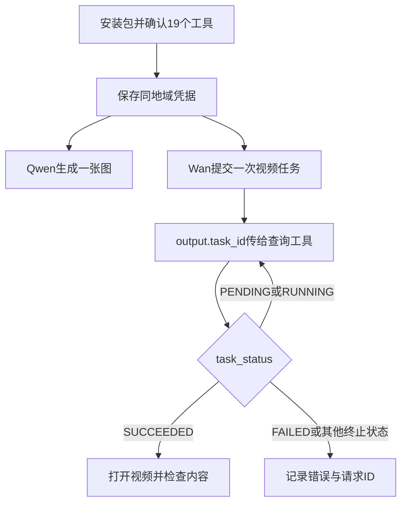

# 0.0.5 最小验收 / Minimum acceptance

## 已执行的无凭据验证

审计基线为 `0aa676d`（PR #1 合并），Python 3.12。原有 12 项 unittest 通过。
新增验证涵盖实际 SDK 注册、凭据错误、HTTPS host、图片缺失、视频提交/查询/下载。
2026-10-12 本地执行结果：SDK 0.9.0 与 0.10.2 各 21 项测试通过；compileall 通过；CLI 实际构建通过，51 个包文件，解压后的 19 个工具注册在两版 SDK 下均通过。GitHub Actions 新增检查尚待本次分支运行。
CLI 采用发布工作流相同的 `dify-plugin-daemon 0.0.6`。
此处验证是本地 SDK 和模拟 HTTP，不能证明百炼服务端接受模型或 Dify 安装成功。

```bash
python -m pip install -r requirements.txt pyyaml
python -m unittest discover -s tests -v
python -m compileall -q main.py provider tools scripts
# 使用与你的平台匹配的官方 dify-plugin CLI；以下为 Linux amd64
curl --fail --location --retry 3 https://github.com/langgenius/dify-plugin-daemon/releases/download/0.0.6/dify-plugin-linux-amd64 -o /tmp/dify-plugin
chmod +x /tmp/dify-plugin
/tmp/dify-plugin plugin package . -o /tmp/tongyi_aigc-0.0.5.difypkg
python scripts/verify_package.py /tmp/tongyi_aigc-0.0.5.difypkg
```

包检查包括 manifest、provider/tool YAML、Python source、图标、privacy 文件；拒绝开发目录、凭据文件和嵌套包，解压后重新执行 SDK 注册（19 个工具）。
测试与验收脚本不进入生产包。SDK最低依赖为 0.9.0；CI 同时测试 0.9.0 和 requirements 当前解析版本。
`meta.version` 沿用既有值，本次不将其理解为独立的 Dify 兼容性证明。

## Dify 安装与注册：无需百炼 Key

1. 在隔离测试工作空间上传该 `.difypkg`，记录包 SHA256、Dify 版本、plugin-daemon 版本、amd64/arm64 架构及安装结果。不要仅使用远程调试模式代替包安装。
2. 按实例现有可信签名策略安装。unsigned 包不等于 Marketplace 已验证包；若签名被拒，由管理员处理可信签名配置。
3. 确认插件身份 `sawyer-shi/tongyi_aigc`、版本 0.0.5，安装任务已完成，19 个工具可见。重点打开 `qwen_text_2_image`、`qwen_image_2_image`、`wan_video`、`wan_video_edit`、`wan_video_query`，确认表单模型选项及参数正常。
4. 确认凭据表单存在 secret API Key 和可选 API Base URL，旧工作流工具名与参数仍可加载。没有 Key 时先不保存；此阶段无需生成请求。
5. 从 Dify compose 目录读取安装日志：`docker compose logs --tail=200 plugin_daemon`。包上传成功但依赖安装/注册失败不算通过。确认运行环境可下载 Python 依赖，宿主机 pip 安装不能代替它。

最低 Dify 版本尚未声明；本地 Python 3.12/SDK 测试不覆盖 Dify 版本矩阵、arm64 运行、签名或实际 daemon 安装。

## 百炼接口冒烟：需要凭据，生成可能收费

模型、Key、业务空间域名同地域且权限匹配；Wan3 填写控制台/官方协议指定的业务空间域名，不照抄占位符。提交和查询必须使用完全相同配置。域名白名单只能验证 URL 形式，不能验证地域或业务空间归属。

在终端安全设置 `DASHSCOPE_API_KEY`、`DASHSCOPE_API_BASE_URL` 环境变量，不提交凭据，不在截图或日志中暴露 Key。以下脚本使用真实插件 ToolRuntime，但绕过 Dify，因此仍需下一节的 Dify 验收。

```bash
# 可选；与 Dify 保存凭据相同，实际调用 qwen-plus，可能收费
python scripts/live_acceptance.py credentials --allow-paid
# 最少一张图；验证返回 IMAGE 消息，可打开图片 URL
python scripts/live_acceptance.py image --allow-paid
# Wan3 最短配置，返回 JSON 中 output.task_id；提交成功不代表生成成功
python scripts/live_acceptance.py video --allow-paid
# 将真实 task_id 替换 TASK_ID；只查询，不重复提交
python scripts/live_acceptance.py query --task-id TASK_ID
# 视频编辑需要已获授权的公开测试视频；另一次计费请求
python scripts/live_acceptance.py edit --video-url https://YOUR_PUBLIC_HOST/test.mp4 --allow-paid
```

查询 PENDING/RUNNING 时等待约 15 秒后再查同一 ID；10 分钟仍未结束就记录状态并停止本次验收，不自动重复提交。SUCCEEDED 必须有可播放 video_url；FAILED 记录 code/message/request_id；CANCELED/UNKNOWN 不算成功。query 退出 0 仅说明查询可执行，必须人工检查 task_status。URL 可能过期，应及时检查。图生图可在 Dify 用已授权的一张小 PNG、简单修改提示词、n=1 验收。

**凭据校验限制：** 当前保存设置会用同一 host 调用 `qwen-plus`（max_tokens=8）。仅视频权限、未开通聊天模型或业务空间不支持 compatible-mode 时可能失败；不能将此失败归因于 Key 一定无效。也不能将聊天成功等同于 Wan3 授权通过。本次未改写校验策略，因为没有凭据验证一个可替代的通用鉴权接口。

## Dify 端到端最小工作流

手工执行（防止自动重复提交产生费用）：



在 Dify Workflow 分别运行上述图片参数和 Wan3 参数，将提交工具的 JSON `output.task_id` 传入 `wan_video_query.task_id`；查询 `download_video=false` 后以 SUCCEEDED 的相同 ID 再测试 `download_video=true`，确认 Dify 输出文件可下载播放。最后选 `wan_video_edit` 输入一个 type=video 的 media JSON，验证同一查询工具能消费其 ID。保留工作流导出及脱敏运行记录。

## 结论记录模板

| 项目 | 通过标准 | 本次状态 |
|---|---|---|
| 离线自动化 | 全部 unittest、compileall、包结构与解压 SDK 注册通过 | 已执行；见审计结果 |
| 实际 Dify 包安装 | 安装完成，19 工具、凭据表单和旧工作流正常 | 未执行：无实例 |
| 百炼图像生成/编辑 | 图片消息含可打开图片，内容符合请求 | 未执行：无凭据 |
| 百炼视频生成/编辑 | task_id 可传递，最终 SUCCEEDED 且视频可播放 | 未执行：无凭据 |
| Dify 异步衔接与下载 | Dify 中 JSON 映射、查询和文件下载均正常 | 未执行：无实例及凭据 |

另发现发布工作流风险：manifest author 是 `sawyer-shi`，自动 checkout 指向该作者的 fork，而非当前仓库 owner；push 使用 `bump-tongyi_aigc-plugin-0.0.5`，创建 Marketplace PR 的 head 却使用 `tongyi_aigc-0.0.5`，两者不同，且失败会被 `|| echo` 掩盖。发布凭据/fork 归属未经确认，本次仅验证包构建，不执行发布。

## English operator summary

Run the offline commands above, upload the resulting package into a staging Dify workspace, and verify version 0.0.5, all 19 tools, credential fields and existing workflows. Record the Dify/daemon versions, architecture and package hash. Dependencies install in the plugin runtime, not on the host. Apply the instance's trusted signing policy.

Only after obtaining authorized credentials, set the two DASHSCOPE environment variables and run the opt-in smoke commands. Credential saving calls qwen-plus and may cost money; it does not establish image/video permissions. Generation also incurs charges. Poll the returned task ID on the same regional/workspace host without resubmitting. Require SUCCEEDED with a playable video URL, and test Dify JSON mapping and file download separately. Neither local mocks nor extracted SDK registration establishes real deployment success.
